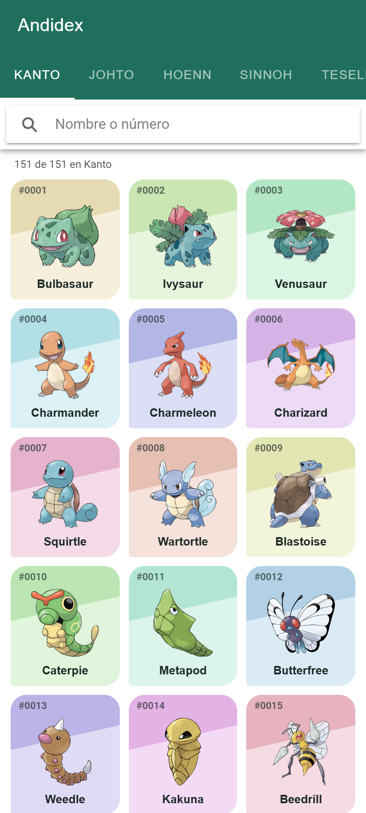
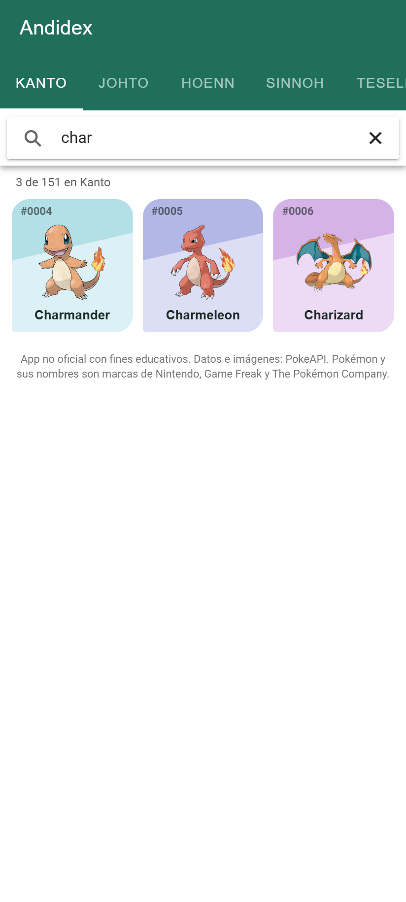
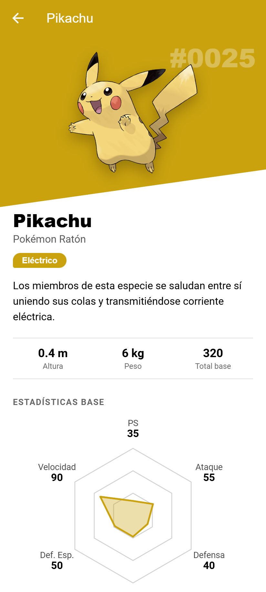
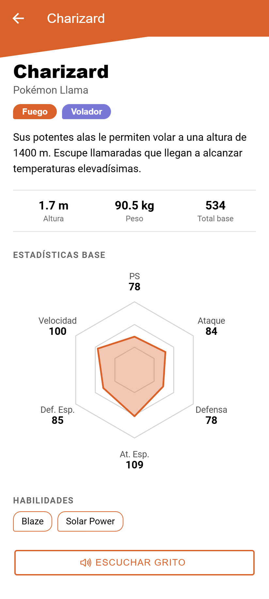
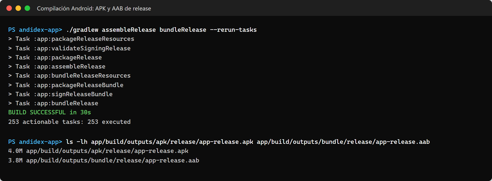

# Andidex

Guía no oficial de criaturas hecha con **Ionic + Angular (componentes standalone)** y
**Capacitor**. Consume la API pública [PokeAPI](https://pokeapi.co).

Deber de Desarrollo de Aplicaciones Móviles (EPN). Integrantes: [Nombre 1] y [Nombre 2].

> App educativa y gratuita. Pokémon y los nombres de sus personajes son marcas de
> Nintendo, Game Freak y The Pokémon Company. Este proyecto no está afiliado a ellas.

## Qué hace

- **Listado por regiones.** Una pestaña por región (Kanto a Paldea); cada región se pide
  a la API en una sola llamada. Búsqueda por nombre o número dentro de la región.
- **Deslizar para actualizar.** Arrastrando la lista hacia abajo se vuelve a pedir la
  región a la API, sin usar la caché.
- **Detalle.** Imagen oficial, nombre, categoría y descripción en español, tipos, altura,
  peso, habilidades, estadísticas base en un radar SVG propio y reproducción del grito.
- **Navegación entre fichas.** Botones Anterior y Siguiente para recorrer las fichas sin
  volver al listado.
- **Acerca de.** Pantalla con la versión, el identificador, los integrantes, el enlace a
  la política de privacidad y el aviso de app no oficial.
- **Modo oscuro.** La app sigue el tema del teléfono, con una paleta propia para fondo
  oscuro.
- **Estados.** Esqueletos de carga, mensaje de error con reintento y caché en memoria.

## Estructura

```
src/app/
├── core/
│   ├── app-info.ts         # nombre, versión e integrantes (pantalla Acerca de)
│   ├── catalogos.ts        # regiones, tipos y etiquetas en español
│   ├── dex.models.ts       # interfaces
│   └── dex.service.ts      # llamadas HTTP a PokeAPI + caché
├── pages/
│   ├── acerca/             # versión, privacidad y aviso legal
│   ├── explorar/           # listado
│   └── ficha/              # detalle
├── ui/
│   └── radar-stats.component.ts
├── app.component.ts
└── app.routes.ts
```

No hay `app.module.ts`: todo se registra en `src/main.ts` con `bootstrapApplication`.

## Requisitos

- Node.js 20 o superior y npm
- Ionic CLI: `npm install -g @ionic/cli`
- Android Studio con el SDK de Android y JDK 21 (para compilar el APK). Gradle 8.14 no
  funciona con Java 25, que es el que trae Android Studio: apuntar `JAVA_HOME` a un JDK 21.

## Instalación y ejecución en el navegador

```bash
git clone https://github.com/Amy-Mishell06/andidex_tienda.git
cd andidex_tienda
npm install
ionic serve
```

Se abre en `http://localhost:8100`.

## Compilación para Android

```bash
ionic build --prod
npx cap add android        # solo la primera vez
npx cap sync android
```

### Ícono y pantalla de inicio

Las imágenes fuente están en `assets/`. Para generar todos los tamaños de Android:

```bash
npm install -D @capacitor/assets
npx capacitor-assets generate --android
```

### Identificador y versión

- Identificador: `ec.epn.moviles.andidex`, definido en `capacitor.config.ts`
  (debe fijarse antes de `npx cap add android`).
- Versión: en `android/app/build.gradle`, dentro de `defaultConfig`:

```gradle
versionCode 1
versionName "1.0.0"
```

### Firma

1. Crear el almacén de claves (una sola vez; guardar el archivo y las contraseñas):

```bash
keytool -genkeypair -v -keystore andidex-release.jks -alias andidex \
  -keyalg RSA -keysize 2048 -validity 10000
```

2. Crear `android/keystore.properties` (no se sube al repositorio):

```properties
storeFile=../../andidex-release.jks
storePassword=TU_CLAVE
keyAlias=andidex
keyPassword=TU_CLAVE
```

3. En `android/app/build.gradle`, antes del bloque `android {`:

```gradle
def keystoreProps = new Properties()
def keystoreFile = rootProject.file("keystore.properties")
if (keystoreFile.exists()) {
    keystoreProps.load(new FileInputStream(keystoreFile))
}
```

   y dentro de `android {`:

```gradle
signingConfigs {
    release {
        if (keystoreFile.exists()) {
            storeFile file(keystoreProps['storeFile'])
            storePassword keystoreProps['storePassword']
            keyAlias keystoreProps['keyAlias']
            keyPassword keystoreProps['keyPassword']
        }
    }
}
buildTypes {
    release {
        signingConfig signingConfigs.release
        // ...lo que ya estaba
    }
}
```

4. Generar los archivos (en Windows usar `gradlew.bat`):

```bash
cd android
./gradlew assembleRelease   # APK: app/build/outputs/apk/release/app-release.apk
./gradlew bundleRelease     # AAB: app/build/outputs/bundle/release/app-release.aab
```

5. Verificar la firma:

El APK se firma solo con el esquema v2 (minSdk 24), así que `keytool -printcert` no lo
reconoce; se usa `apksigner`, que está en `build-tools` del SDK. El AAB sí se verifica con
`keytool`.

```bash
apksigner verify --print-certs app/build/outputs/apk/release/app-release.apk
keytool -printcert -jarfile app/build/outputs/bundle/release/app-release.aab
certutil -hashfile app\build\outputs\apk\release\app-release.apk SHA256
```

### Instalar en el teléfono

```bash
adb install app/build/outputs/apk/release/app-release.apk
```

## Capturas

### Aplicación

| Listado | Búsqueda | Otra región |
| --- | --- | --- |
|  |  |  |

| Detalle | Estadísticas y grito | Ícono |
| --- | --- | --- |
|  |  |  |

### Compilación y firma

Compilación web de producción:


APK y AAB de release:



Verificación de la firma:


Identificador, versión y permisos:


## Publicación

Canal elegido: **Uptodown** (tienda alternativa). Enlace público: [pendiente].
El detalle del envío y su estado están en el informe PDF.

## Privacidad

La app no recoge datos personales. Ver [PRIVACY.md](PRIVACY.md).

## Créditos

- Datos, imágenes y sonidos: [PokeAPI](https://pokeapi.co)
- Repositorio de referencia del curso: https://github.com/jzaldumbide/pokedex-2026b
